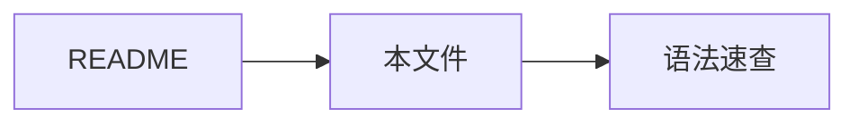

# 自举验证文档

本文档用于墨阅（Sumi）的端到端验证：用阅读器阅读阅读器自己的文档。

## 本地图片（asset 协议）

下方图片位于 `assets/test-image.png`，用于验证相对路径图片经 asset 协议加载：


## 渲染特性清单

### 代码块

```rust
fn main() {
    println!("Hello, MD Reader!");
}
```

### 数学公式

行内公式 $e^{i\pi} + 1 = 0$，块级公式：

$$\int_0^1 x^2\,dx = \frac{1}{3}$$

### Mermaid



### 任务列表

- [x] 项目脚手架
- [x] 渲染引擎
- [ ] 端到端验证

### 表格

| 验证项 | 预期 |
| --- | --- |
| 图片加载 | asset 协议 200 |
| 代码高亮 | rust 语法着色 |
| 公式 | KaTeX 渲染 |
| Mermaid | SVG 输出 |

## 链接

- 外链：[Tauri 官网](https://tauri.app)
- 内链：[语法速查](Markdown%20语法速查.md)

[^1]: 这是一条脚注。


## 编辑测试标题

这是**实时**

| 列1 | 列2 | 列3 |
| --- | --- | --- |
| 内容 | 内容 | 内容 |


| 列1 | 列2 | 列3 |
| --- | --- | --- |
| 内容 | 内容 | 内容 |

。